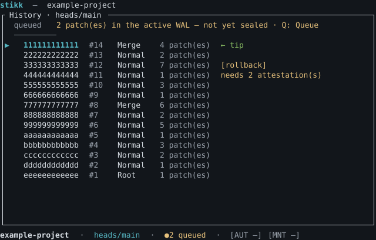
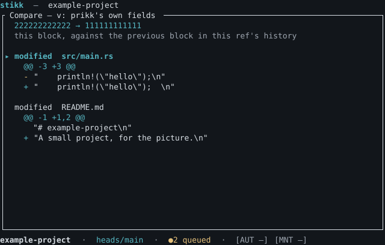
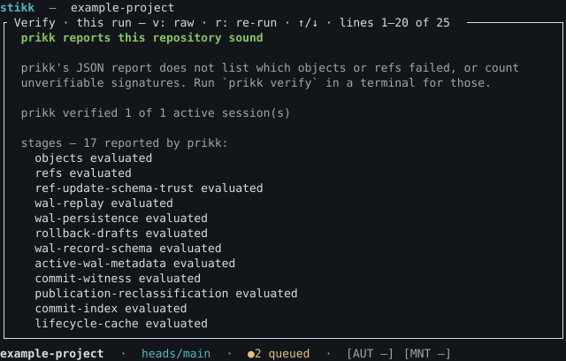

# stikk

[](https://prikk-vcs.github.io/stikk/)
[](LICENSE)
[](https://github.com/prikk-vcs/stikk/actions/workflows/ci.yml)    
[Report a vulnerability](SECURITY.md)

**stikk is a history browser and workbench for the [prikk](https://github.com/nabbisen/prikk)
version control system** — a terminal (TUI) front-end, with a graphical (GUI) one planned, over one shared
operation layer.







*Drawn by stikk's own views from invented data, not photographed — see
[RFC 042](rfcs/accepted/042-readme-key-visuals.md).*

## Overview

prikk is a distributed VCS built around block-oriented patch theory. stikk sits on top of it to
navigate, inspect, and operate on prikk history. Its founding property — from which the whole design
follows — is that **stikk owns no repository authority and no secrets**: every repository fact is
re-derived from prikk, and prikk (never stikk) reads signing key material. Its stance mirrors
prikk's own: *where prikk refuses, stikk explains.*

The name is Norwegian for *to set a course, to take a bearing.*

## Why / when

Reach for stikk when you want to read and work with prikk history without memorizing the CLI, and
when you want prikk's refusals — non-confluent merges, trust conflicts, integrity findings —
explained rather than dumped. stikk never guesses about history and never presents imported or
unverifiable authorship as sound: it makes prikk's own truth legible.

It is **not** a second prikk CLI (VCS verbs stay prikk's), not a network tool (prikk moves no bytes),
and not a place your signing keys live.

## Install

stikk needs two programs: **prikk** (the version control system itself) and **stikk** (this
program, which shows you what is in a prikk repository). Neither needs a compiler — both ship as
ready-to-run files. A *terminal* is the window where you type commands; everything below is typed
there.

**One command.** On **Linux and macOS**:

```sh
curl -fsSL https://github.com/prikk-vcs/stikk/releases/latest/download/install.sh | sh
```

On **Windows**, in PowerShell:

```powershell
irm https://github.com/prikk-vcs/stikk/releases/latest/download/install.ps1 | iex
```

It downloads stikk, checks it against the checksum published beside it, installs nothing if that
check fails, and puts stikk somewhere your terminal can find it. **If prikk is missing it offers to
install it too**, using prikk's own installer and the prikk version this stikk was tested against —
answer `n` to skip, or pass `--with-prikk` / `--no-prikk` to decide in advance. Run it again any
time to upgrade. On Windows, prikk has no installer of its own, so the script tells you where to
get it rather than guessing.

To remove stikk later:

```sh
curl -fsSL https://github.com/prikk-vcs/stikk/releases/latest/download/uninstall.sh | sh
```

It removes stikk and the `PATH` entry it added, and nothing else. **It never removes prikk** — and
if the installer brought prikk in, prikk added its own `PATH` entry, which is prikk's to remove
(`curl -fsSL https://github.com/prikk-vcs/prikk/releases/latest/download/uninstall.sh | sh`).

The script is one file and is meant to be read before it is run — open the URL in a browser first
if you would rather see it. The rest of this section is the same thing by hand.

### Or, by hand

#### 1. Install prikk

prikk publishes its own installer. One line:

```sh
curl -fsSL https://github.com/prikk-vcs/prikk/releases/latest/download/install.sh | sh
```

It downloads prikk, checks the download against the checksum prikk published, installs it into
`~/.local/bin`, and adds that folder to your `PATH` — the list of places your terminal looks for
programs. **If it changed your `PATH`, open a new terminal before carrying on.** Then:

```sh
prikk --version
```

stikk works with prikk **0.28 and above, and is tested through 0.52.0** — which is what the command
above installs today. To ask for exactly that version rather than the newest one:

```sh
curl -fsSL https://github.com/prikk-vcs/prikk/releases/latest/download/install.sh | sh -s -- --version 0.51.0
```

**prikk's installer covers Linux and Apple-Silicon Macs only.** On Windows, or on an Intel Mac, use
prikk's own [install guide](https://github.com/prikk-vcs/prikk/blob/main/docs/src/guide/install.md).

#### 2. Install stikk

Find the row for your computer — the commands below download that file for you, from the
[latest release](https://github.com/prikk-vcs/stikk/releases/latest):

| Your computer | File to download |
|---|---|
| Linux, Intel/AMD | `stikk-0.12.0-x86_64-unknown-linux-gnu.tar.gz` |
| Linux, Intel/AMD (older systems) | `stikk-0.12.0-x86_64-unknown-linux-musl.tar.gz` |
| Linux, ARM | `stikk-0.12.0-aarch64-unknown-linux-gnu.tar.gz` |
| Mac, Apple Silicon (M1 and later) | `stikk-0.12.0-aarch64-apple-darwin.tar.gz` |
| Mac, Intel | `stikk-0.12.0-x86_64-apple-darwin.tar.gz` |
| Windows | `stikk-0.12.0-x86_64-pc-windows-msvc.zip` |

Each file has a second file beside it ending in `.sha256`. That is a *checksum*: a short fingerprint
of the download, so you can tell the file arrived exactly as published. The commands below fetch
both. **Use them rather than downloading in a browser** — on macOS a browser download is treated as
untrusted and the program will be refused the first time you run it (see the macOS note below).

**Linux**

```sh
curl -fLO https://github.com/prikk-vcs/stikk/releases/download/0.12.0/stikk-0.12.0-x86_64-unknown-linux-gnu.tar.gz
```

```sh
curl -fLO https://github.com/prikk-vcs/stikk/releases/download/0.12.0/stikk-0.12.0-x86_64-unknown-linux-gnu.tar.gz.sha256
```

Check the download, so you know it was not altered on the way:

```sh
sha256sum -c stikk-0.12.0-x86_64-unknown-linux-gnu.tar.gz.sha256
```

That prints `stikk-0.12.0-x86_64-unknown-linux-gnu.tar.gz: OK`. **If it says `FAILED`, stop and
download again — do not run the file.** Then unpack it and put it somewhere your terminal looks:

```sh
tar -xzf stikk-0.12.0-x86_64-unknown-linux-gnu.tar.gz
```

Make the folder you are going to keep it in, in case it does not exist yet:

```sh
mkdir -p ~/.local/bin
```

```sh
install -m755 stikk-0.12.0-x86_64-unknown-linux-gnu/stikk ~/.local/bin/stikk
```

**macOS** is the same — `curl`, check, `tar -xzf`, `mkdir -p ~/.local/bin`, `install` — with the Mac
file name and one different check command (replace `aarch64-apple-darwin` with
`x86_64-apple-darwin` on an Intel Mac):

```sh
shasum -a 256 -c stikk-0.12.0-aarch64-apple-darwin.tar.gz.sha256
```

**Download with the `curl` commands above, not with a browser.** macOS marks anything a browser
downloads as quarantined, and refuses to run a quarantined program that has not been notarized —
stikk is not — with a warning there is no obvious way past. Files fetched with `curl` are not
marked. If you already used a browser and macOS refuses to open stikk, clear the mark:

```sh
xattr -d com.apple.quarantine ~/.local/bin/stikk
```

**Windows**, in PowerShell. There is no `sha256sum` here, so you compare the fingerprint yourself:

```powershell
Invoke-WebRequest -Uri https://github.com/prikk-vcs/stikk/releases/download/0.12.0/stikk-0.12.0-x86_64-pc-windows-msvc.zip -OutFile stikk.zip
```

```powershell
Invoke-WebRequest -Uri https://github.com/prikk-vcs/stikk/releases/download/0.12.0/stikk-0.12.0-x86_64-pc-windows-msvc.zip.sha256 -OutFile stikk.zip.sha256
```

```powershell
if ((Get-FileHash stikk.zip -Algorithm SHA256).Hash -eq (((Get-Content stikk.zip.sha256 -Raw).Trim() -split '\s+')[0])) { "OK" } else { "FAILED - do not use this file" }
```

```powershell
Expand-Archive stikk.zip -DestinationPath .
```

That leaves `stikk-0.12.0-x86_64-pc-windows-msvc\stikk.exe`. Move it into a folder on your `PATH`.

If `~/.local/bin` (or the folder you chose) is not already on your `PATH`, add it — on Linux and
macOS, `export PATH="$HOME/.local/bin:$PATH"` in your shell's startup file, then open a new
terminal.

Check it worked:

```sh
stikk --version
```

It prints `stikk 0.12.0`.

#### Optional: check who built it

The checksum proves the file was not altered on the way to you. It does **not** prove who built it.
If you want that too, and you have [GitHub CLI](https://cli.github.com/):

```sh
gh attestation verify stikk-0.12.0-x86_64-unknown-linux-gnu.tar.gz -R prikk-vcs/stikk
```

It exits successfully when the file really was built by this project's release workflow, and fails
otherwise.

### If you already use Rust

```sh
cargo install stikk
```

This compiles stikk from source, so it takes a few minutes and needs a Rust toolchain
(2024 edition, MSRV 1.88). To download the same prebuilt binary the installer uses, without
compiling:

```sh
cargo binstall stikk
```

The one-line installers above need neither.

## Quick start

Make a repository, or go into one you already have:

```sh
prikk init
```

Open it:

```sh
stikk
```

Press `?` for help and the full key reference. `q` or `Esc` leaves.

Launcher utilities:

```sh
stikk --version
stikk config path          # where stikk's config and state live (never inside a repository)
stikk config check         # validate the config file
```

If prikk is installed somewhere your terminal does not look, point stikk at it:

```sh
export STIKK_PRIKK_BIN=/path/to/prikk
```

stikk requires prikk **≥ 0.28** and is validated through **0.52.0**; a newer prikk still runs, but
stikk says its output shapes have not been checked against it, rather than assuming they have.

Opening a repository on a terminal launches the interactive **TUI** — an Orientation view showing
prikk version and support, queue depth, signing readiness, and your derived capability, inside a shell
with a status bar and a Help overlay (`?`). Run it piped or in CI and you get the same orientation as a
one-shot print instead. The TUI is built on `ratatui` (RFC 001), and from there you can open History and
Block detail, worktree Changes and the Queue view, **Patch detail** — what one patch changed, from
prikk's own report, with content shown byte for byte — **Compare**, what changed between two points
in prikk's own `diff` hunks (prikk ≥ 0.46), including **any two refs** marked and selected in the
ref picker, **Verify** (`V`) — prikk's verdict on whether the repository is sound, with its failing
conditions and every stage it ran (prikk ≥ 0.39) — and commit or seal behind preview-first
confirmation.
To see it with no repository at all, from a clone of
this repository: `cargo run -p stikk-tui --example orientation_demo`.

stikk never reads a seed's value. On prikk ≥ 0.41 it asks prikk for signing readiness (`prikk key
status`); below that it checks only whether `PRIKK_*_KEY_ID` and `PRIKK_*_SEED` are set. Set
`STIKK_READ_ONLY=1` to force a read-only session.

## Design notes

- **The prikk seam is the only door to prikk.** One crate (`stikk-prikk`) talks to prikk; a CLI
  backend ships first (output parsing confined and version-gated, with an EPIPE guard), a linked
  library backend is deferred behind the same trait. Nothing above the seam knows *how* prikk is
  reached.
- **stikk owns no repository truth.** Every stikk-owned datum is a deletable convenience re-resolved
  against prikk on use; cutting all of stikk's state leaves every repository byte-identical. stikk's
  files live in user scope and a path resolver refuses any repository-internal target before every
  write — the *primary* control, since prikk has no foreign-file backstop.
- **No key material ever enters stikk.** It asks prikk for signing readiness on prikk ≥ 0.41 and reads
  signing-key *presence* only below that; prikk reads seeds itself. This is enforced by test, not just
  convention.
- **One operation layer, two frontends.** The TUI and GUI drive the same operations, so parity is
  mechanical, not maintained by hand.

## Project Status

### Crates

| Crate | Purpose | Version | Docs | Dependencies |
|---|---|---|---|---|
| [`stikk`](https://crates.io/crates/stikk) | A user-facing history browser and workbench for the prikk version control system (the launcher binary). | [](https://crates.io/crates/stikk) | [](https://prikk-vcs.github.io/stikk/) | [](https://deps.rs/crate/stikk) |
| [`stikk-core`](https://crates.io/crates/stikk-core) | The operation layer: one shared operation set both frontends drive. Owns no I/O and no widgets; orchestrates the seam, state, and view-models. | [](https://crates.io/crates/stikk-core) | [](https://docs.rs/stikk-core) | [](https://deps.rs/crate/stikk-core) |
| [`stikk-model`](https://crates.io/crates/stikk-model) | Shared kernel for stikk: error taxonomy, object/ref identity, request categories, and capabilities. No I/O. | [](https://crates.io/crates/stikk-model) | [](https://docs.rs/stikk-model) | [](https://deps.rs/crate/stikk-model) |
| [`stikk-prikk`](https://crates.io/crates/stikk-prikk) | The prikk seam: the only code in stikk that talks to prikk. CLI backend, version handshake, and signing readiness — from prikk itself where it reports it, and presence only otherwise. | [](https://crates.io/crates/stikk-prikk) | [](https://docs.rs/stikk-prikk) | [](https://deps.rs/crate/stikk-prikk) |
| [`stikk-state`](https://crates.io/crates/stikk-state) | stikk's own durable data: config, sessions, recents. Lives in user scope, never inside a repository, and is never authority. | [](https://crates.io/crates/stikk-state) | [](https://docs.rs/stikk-state) | [](https://deps.rs/crate/stikk-state) |
| [`stikk-tui`](https://crates.io/crates/stikk-tui) | The terminal (TUI) frontend for stikk. Renders the operation layer's view-models; computes nothing about the repository. | [](https://crates.io/crates/stikk-tui) | [](https://docs.rs/stikk-tui) | [](https://deps.rs/crate/stikk-tui) |

### Project Structure

stikk is a five-layer workspace, dependencies pointing strictly downward: `stikk-model` (shared kernel,
no I/O) ← `stikk-prikk` (the seam — the only code that talks to prikk) and `stikk-state` (user-scope
config/session) ← `stikk-core` (the one operation layer both frontends drive) ← the frontends
(`stikk-tui` today) and the `stikk` launcher. See
[`docs/src/contributing/development.md`](docs/src/contributing/development.md) for the full picture.

## More detail

The full design set lives in [`docs/src`](docs/src) (mdBook), organized by reader:

- **New users** — the guide (getting started, orientation).
- **Reference** — the design documents: requirements, external design, internal design, data model,
  and the security threat model.
- **Contributors** — [CONTRIBUTING.md](CONTRIBUTING.md), the workflow, and the testing discipline.

Where stikk is headed: see [ROADMAP.md](ROADMAP.md). Security: see [SECURITY.md](SECURITY.md).
Changes: see [CHANGELOG.md](CHANGELOG.md).
